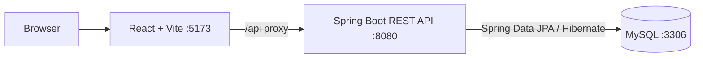

# Esports Tournament Management System

A full-stack web application for managing esports players, teams, tournaments, and matches. The project combines a **Spring Boot REST API**, **React + Vite frontend**, and **MySQL** database.

<p align="center">
  
  
  
  
  
  
</p>

## Contents

- [What the project does](#what-the-project-does)
- [Technology stack](#technology-stack)
- [Architecture](#architecture)
- [Getting started](#getting-started)
- [API overview](#api-overview)
- [Repository layout](#repository-layout)
- [Development notes](#development-notes)
- [Contributing](#contributing)
- [License](#license)

## What the project does

The application provides a single place to manage the core data used by an esports tournament:

- **Players** — view and register player profiles.
- **Teams** — view team records and register teams.
- **Tournaments** — list tournaments and create new tournament records.
- **Matches** — view scheduled matches and match results.
- **Dashboard** — access a summary of tournament-related information.

The current repository contains the core management flows. Authentication, role-based access control, production deployment, and automated bracket generation are not currently included.

## Technology stack

| Layer | Technology |
| --- | --- |
| Frontend | React 18, Vite 5, React Router, Axios, Tailwind CSS |
| Backend | Java 21, Spring Boot 3, Spring Web, Spring Data JPA |
| Persistence | MySQL 8, Hibernate |
| Build tools | npm, Maven |
| Icons | Lucide React |

## Architecture

The frontend makes requests to the `/api` path. During local development, the Vite development server proxies those requests to the Spring Boot API at `http://localhost:8080`. This keeps browser requests on the same origin and avoids relying on a changing local-network IP address.



## Getting started

### Prerequisites

Install the following tools:

- **Java JDK 21**
- **Apache Maven 3.9+**
- **Node.js 18+ and npm**
- **MySQL Server 8+**

Verify the command-line tools are available:

```powershell
java -version
mvn -version
node --version
npm --version
```

### 1. Create the database

Start MySQL Server, connect using MySQL Workbench or the MySQL command-line client, and create the database:

```sql
CREATE DATABASE esports_tournament;
```

The application uses Hibernate's `ddl-auto=update` setting to update the schema from the JPA entities when the backend starts. For a production system, use versioned database migrations instead.

### 2. Configure the backend

The backend reads its connection settings from environment variables. Defaults are provided for the local URL and username; set your own MySQL password in the terminal before launching the backend.

**PowerShell:**

```powershell
$env:DB_URL = "jdbc:mysql://localhost:3306/esports_tournament?createDatabaseIfNotExist=true&useSSL=false&allowPublicKeyRetrieval=true"
$env:DB_USERNAME = "root"
$env:DB_PASSWORD = "YOUR_LOCAL_MYSQL_PASSWORD"

cd backend
mvn spring-boot:run
```

Keep this terminal open. The API starts at `http://localhost:8080`.

> Replace `YOUR_LOCAL_MYSQL_PASSWORD` locally. Never commit your actual password, database dumps containing private data, or real credentials.

### 3. Start the frontend

Open a **second terminal** from the repository root:

```powershell
cd frontend
npm install
npm run dev
```

Open the URL printed by Vite (normally [http://localhost:5173](http://localhost:5173)).

The frontend development server forwards `/api` requests to the backend on port `8080`. Keep both terminals and MySQL Server running while using the application.

### Optional: Windows launcher

After Java, Maven, Node.js, npm, and MySQL are configured, you can run `start.bat` from the repository root to open separate backend and frontend terminal windows.

For a more detailed walkthrough, see [setup_guide.md](setup_guide.md).

## API overview

The backend exposes these REST endpoints under `/api`:

| Method | Endpoint | Purpose |
| --- | --- | --- |
| GET | `/players` | List players |
| POST | `/players` | Register a player |
| GET | `/teams` | List teams |
| POST | `/teams/register` | Register a team |
| GET | `/tournaments` | List tournaments |
| POST | `/tournaments` | Create a tournament |
| GET | `/matches` | List matches |
| GET | `/matches/results` | List match results |

Example: with the backend running, visit [http://localhost:8080/api/tournaments](http://localhost:8080/api/tournaments) to inspect the tournament API response.

## Repository layout

```text
.
├── backend/
│   ├── src/main/java/com/esports/tournament/
│   │   ├── controller/       # REST endpoints
│   │   ├── entity/           # JPA entities
│   │   ├── repository/       # Spring Data repositories
│   │   └── service/          # Application services
│   ├── src/main/resources/
│   │   └── application.properties
│   └── pom.xml
├── frontend/
│   ├── src/
│   │   ├── api/              # Axios API client
│   │   ├── components/       # Shared UI components
│   │   └── pages/            # Dashboard and management pages
│   ├── vite.config.js
│   └── package.json
├── .github/workflows/        # Continuous integration
├── docs/                    # Architecture and project notes
├── setup_guide.md
└── start.bat
```

## Development notes

- Run backend and frontend in separate terminals during development.
- The frontend uses a relative API base path (`/api`) and the Vite proxy configuration in `frontend/vite.config.js`.
- The backend uses environment variables `DB_URL`, `DB_USERNAME`, and `DB_PASSWORD` for database configuration.
- Do not commit local `.env` files, passwords, access tokens, or personal database exports.
- The CI workflow checks the backend with Maven and builds the frontend with Vite.

## Contributing

Bug reports and improvements are welcome. Please read [CONTRIBUTING.md](CONTRIBUTING.md) before opening a pull request. For security-sensitive reports, see [SECURITY.md](SECURITY.md).

## License

Distributed under the MIT License. See [LICENSE](LICENSE) for details.
