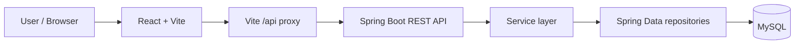

# Architecture

## Overview

The application is split into a React frontend and a Spring Boot REST API. The API uses Spring Data JPA and Hibernate to persist data in MySQL.

## Frontend

- React provides the UI.
- React Router handles page navigation.
- Axios is used for HTTP requests.
- Vite serves the development app and proxies `/api` requests to the backend at `http://localhost:8080`.

Relevant source directories:

- `frontend/src/pages/` — Dashboard, Players, Tournaments, Matches, and Register pages.
- `frontend/src/components/` — shared UI components.
- `frontend/src/api/` — API client configuration.

## Backend

The Spring Boot application is organized into:

- `controller/` — REST endpoints.
- `service/` — application/business operations.
- `repository/` — Spring Data JPA repositories.
- `entity/` — JPA persistence models.

The main application class is `TournamentApplication.java`.

## Persistence

MySQL stores application records. Hibernate is configured with `ddl-auto=update` for local development. A production deployment should use explicit schema migrations and a separately managed database account.

Database connection settings are read from:

- `DB_URL`
- `DB_USERNAME`
- `DB_PASSWORD`

## Local request flow

The browser calls relative paths such as `/api/tournaments`. Vite proxies those requests to the Spring Boot service on port `8080`. This approach avoids hard-coding a machine-specific LAN address in the frontend.
